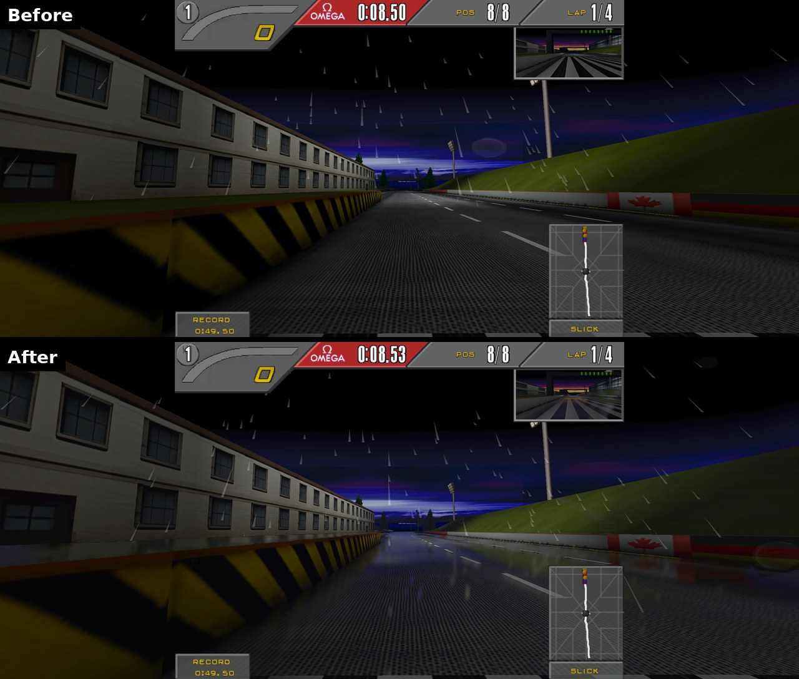
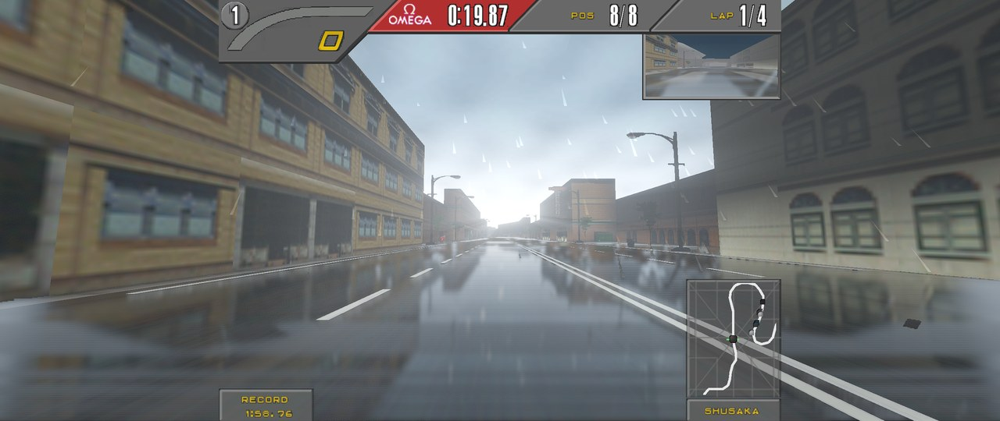
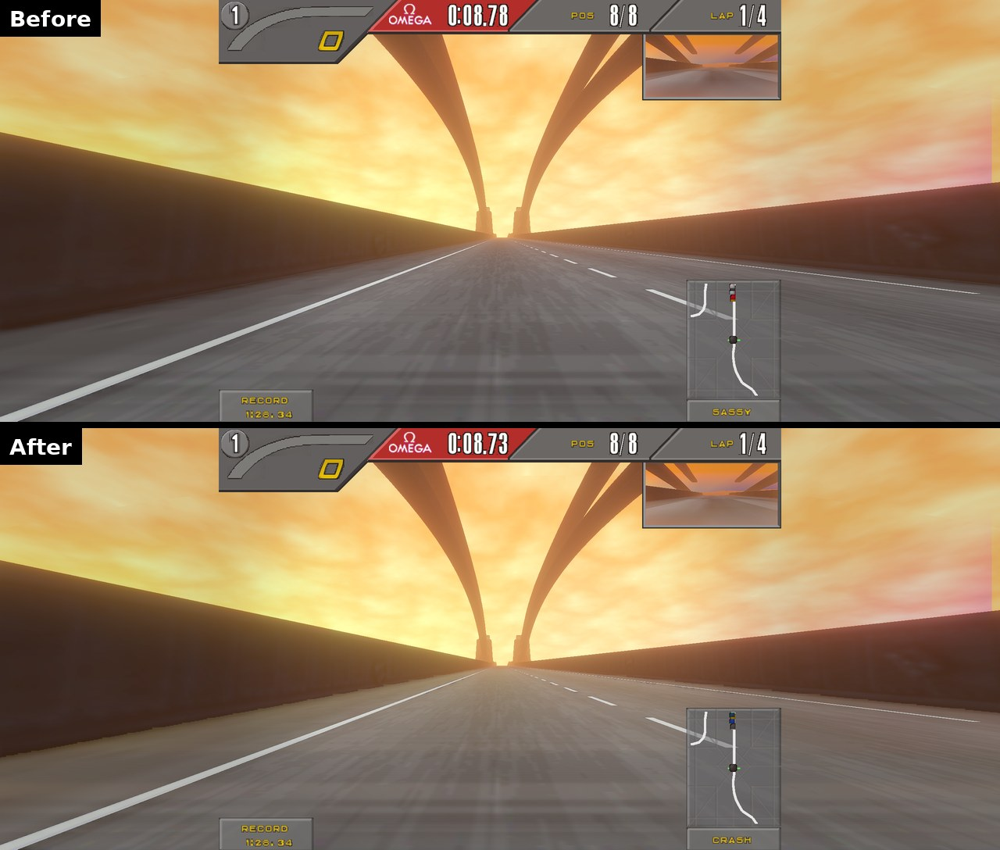
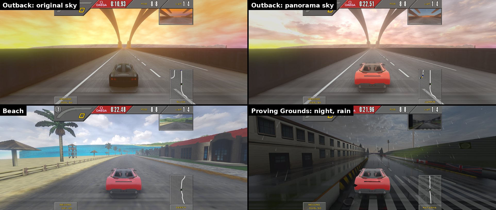
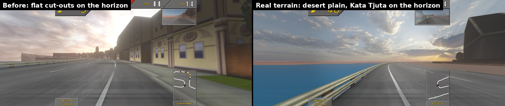
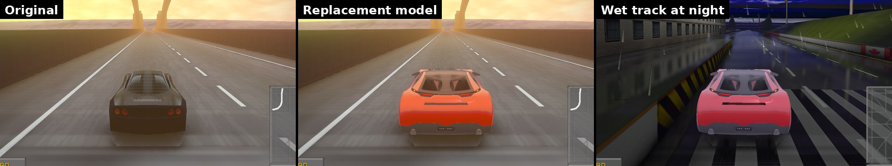

NFSIISE
=======


Cross-platform wrapper for the Need For Speed™ II SE game with 3D acceleration and TCP protocol!

### About this fork

This fork of [zaps166/NFSIISE](https://github.com/zaps166/NFSIISE) adds a remastered look to the desktop OpenGL 2 renderer while keeping the original game:

* **true widescreen** (Hor+) - ultrawide and 16:9 screens show a wider field of view, HUD and menus stay 4:3,
* **modern image quality** - supersampling, MSAA, FXAA, sharpening, mipmaps with anisotropic filtering,
* **lighting and atmosphere** - ambient occlusion, HDR bloom, filmic grading, accurate per-pixel fog,
* **HD texture packs** - dump the game textures, upscale them (e.g. with AI upscalers) and load them back.

See [Graphics enhancements](#graphics-enhancements-opengl-2) for details. Everything can be toggled in game with `Alt+P` to compare with the original look.

## GIT clone:

Don't forget to update submodules:
```sh
git submodule update --init --recursive
```

The game code is in `src/Asm/NFS2SE.asm` (in this fork it is part of the repository, patched for widescreen) and `src/Cpp` (submodule, used only by the `cpp` build).

## OpenGL

* By default OpenGL 2 is used (except Android - it always uses GLES2).
* To use OpenGL 1, add `gl1` argument to compilation script.
* To use OpenGL|ES 2, add `gles2` argument to compilation script.

## Compile for x86:

* To compile the game, you must have:
  * GCC or Clang compiler which can generate **32-bit** code for x86 (set by `$CC` environment variable),
  * **32-bit** OpenGL devel and drivers,
  * **32-bit** SDL2 devel.
  * Yasm assembler,
* On **Debian** you should add 32-bit architecture and install 32-bit dependencies (run as `root`):
```sh
dpkg --add-architecture i386
apt-get update
apt-get install libsdl2-dev:i386 gcc-multilib yasm
```
* Edit the `compile_nfs` script, modify what do you want. Compile the game by executing the script - it will automatically generate executable file inside `Need For Speed II SE` directory:
  * `./compile_nfs` - native compilation for Unix-like systems (Linux, macOS up to Mojave, ...),
  * `./compile_nfs win32` - cross compilation for Windows (on Arch Linux install: `mingw-w64-gcc` and `mingw-w64-sdl2` from AUR).

## Notes About Windows Build using WSL:
* One way is to use WSL (Windows Subsystem for Linux) and install `mingw-w64` which cross-compiles to Windows
```sh
sudo apt install mingw-w64
```
also `gcc-multilib` might be needed to be installed using
```sh
sudo apt install gcc-multilib
```

* Don't install SDL using apt-get, instead take it from their [official repo packages page](https://github.com/libsdl-org/SDL/releases/), get the package with **mingw** suffix

* Inside the package folder you should use the one called *`i686-w64-mingw32`*
* Either copy the `include, bin, lib, share` to your system files (not recommended) or you can modify the following lines in the file `compile_nfs`:

  - On line 27 with:
      ```sh
      C_FLAGS="$COMMON_FLAGS -O2 $CPU_FLAGS"
      ```
      add before the last quotation mark `-I/path/to/include/folder` so that it becomes:
      ```sh
      C_FLAGS="$COMMON_FLAGS -O2 $CPU_FLAGS -I/path/to/include/folder"
      ```

  - On line 23 add the same include directory paramter before the quote

  - On line 39 which has:
      ```sh
      i686-w64-mingw32-ld --enable-stdcall-fixup -o "../Need For Speed II SE/nfs2se.exe" *.o --stack=0x7D00,0x7D00 --heap=0x2000,0x1000 -lws2_32 -lwinmm -lmingwex -lmsvcrt -lkernel32 -lopengl32 -lSDL2 -lSDL2main -lSDL2_test -subsystem=$WIN_SUBSYSTEM $STRIP -e _start &&
      ```
      After the `-lSDL2_test` add `-L/path/to/lib/folder/`
  - Now the command `./compile_nfs win32` should work fine
  - If you try to run the exe, windows will say the dll is missing so you should get it from the `same SDL packages link` but this time the package for `win32-x86`
  - Copy the dll you get from decompressing the zip file and put it in the same directory as the game's exe file
  - Now if you follow the other steps (of copying game data and dealing with possible errors explained futher), it should work fine

## Compile for non-x86 CPUs:

### Information:
* This game can run on ARM devices, also on Android. Only **32-bit little-endian** CPUs are supported.
* The performance is a bit lower than the original assembly code.
* May be less stable than assembly code due to possible translation bugs.

### Requirements:
* SDL2 (32-bit) and OpenGL (32-bit).
* Clang compiler and lld linker (must generate 32-bit output).

### Compilation:

#### Linux:
* run `./compile_nfs cpp`

#### Android:
* install SDK and NDK for chosen SDL2 version,
* set environment variables: `ANDROID_HOME` and `ANDROID_NDK_HOME`,
* download SDL2 source code and unpack it,
* create symlink to unpacked `SDL2-*` directory into `src/Android/app/jni/SDL`,
* run `./compile_nfs android` or `./compile_nfs android install`.

## Run:

* Copy `fedata` and `gamedata` directories from the Need For Speed™ II SE original CD-ROM into `Need For Speed II SE` directory.
* This game **needs** data from Need For Speed 2 **Special Edition**, otherwise you'll see a 'MOVIE FILE NOT FOUND' message!
* You can delete unnecessary files, e.g. `fedata/pc/text/text.*`, because TCP version uses new files in root directory.
* All files and directories copied from CD-ROM **must** have *small letters* on Unix-like systems!!!
  * Please use the `Need For Speed II SE/convert_to_lowercase` script if you have UPPERCASE names.
* If you want to change the language, edit `install.win` file (with text editor which doesn't modify last line or line edings!) and change the first line. Leave `4nn` as is and modify only language name. Possible languages are:
  * english,
  * french,
  * german,
  * italian,
  * spanish,
  * swedish.
* Run the game.
* The game settings files are located in `~/.nfs2se` (`%AppData%\.nfs2se` on Windows). At the first run, the `nfs2se.conf.template` will be copied there. You can modify the file if you want to configure the game. On Windows, you can use `open_config.bat` to open the config file in notepad.
* On Android devices, copy `gamedata`, `fedata`, `install.win`, `text.*`, `nfs2se.conf` (rename `nfs2se.conf.template` to `nfs2se.conf`) into `/sdcard/NFSIISE` or `/storage/emulated/0/NFSIISE` (create `NFSIISE` directory first).
* For Batocera Linux devices (an open-source and completely free retro-gaming distribution), tested with version 39:
  * take Windows version (e.g `nfs2se-win32-v1.4.0.zip` under Releases), unpack it,
  * copy original `fedata` and `gamedata` directories into `Need For Speed II SE` directory,
  * in `Need For Speed II SE` directory create new file `autorun.cmd` with content `CMD=nfs2se.exe`,
  * rename directory `Need For Speed II SE` to `Need For Speed II SE.pc`,
  * place directory `Need For Speed II SE.pc` into your Batocera Linux directory `/userdata/roms/windows/`,
  * to update the game list in Batocera using your controller, press `START` and go to `GAME SETTINGS` → `UPDATE GAMELISTS`, the game is listed under `Windows` section and will be successfully emulated via Wine

## Graphics enhancements (OpenGL 2):

Available in the desktop OpenGL 2 build (the default `./compile_nfs`). Everything is configured in `nfs2se.conf` (see the "Graphics enhancements" section of `nfs2se.conf.template`) and enabled by default. Existing configuration files keep working - missing options use the defaults.

### Widescreen

On windows wider than 4:3 the game renders a wider horizontal field of view (Hor+) instead of stretching or pillarboxing the picture. The HUD, the rear-view mirror and menus stay 4:3 in the middle of the screen, so they are never distorted. The sky backdrop is widened to reach the screen edges.

* `Widescreen=1` - enabled (default), `Widescreen=0` - original 4:3 picture (see `KeepAspectRatio`).
* `HudCorners=1` (default) - in a race the bottom HUD boxes (minimap with the opponent's name, the record box) move to the screen corners so they don't cover the road; the top bar and the mirror stay in the middle. `HudCorners=0` keeps the whole HUD 4:3 in the middle.
* Works with any aspect ratio (16:9, 21:9, 32:9); the field of view follows the window shape.
* Requires the x86 build - the game code in `src/Asm` is patched for it. The `cpp` build shows a stretched picture.
* After changing the window shape (e.g. `Alt+Enter`), the new field of view is used from the next race.

### Image quality

* `RenderScale` - internal resolution multiplier. `2.0` renders at twice the resolution (4x supersampling) and downsamples, which gives the cleanest image. On very high resolution screens (e.g. 5120x2160) `1.0` - `1.5` is usually enough.
* `MSAA` - off-screen multisample anti-aliasing (2, 4, 8, 16).
* `FXAA`, `Sharpen` - post-process anti-aliasing and contrast adaptive sharpening.
* `Mipmaps`, `AnisotropicFiltering` - removes shimmering of distant textures; cut-out textures (trees, fences) keep their shape at a distance.

### Lighting and atmosphere

* `AmbientOcclusion`, `AmbientOcclusionRadius` - screen-space ambient occlusion (contact shadows at walls, curbs, under cars and trees).
* `Bloom`, `BloomThreshold` - glow of bright sky and lights.
* `ToneMapping`, `Exposure`, `Contrast`, `Saturation`, `Warmth` - filmic grading.
* `Vignette`, `FilmGrain` - camera effects.
* `PerPixelFog` - the game's fog table is evaluated per pixel instead of per vertex, so distant scenery fades into the haze correctly.
* `Reflections`, `Wetness` - screen-space reflections on the road. Surfaces that face up and are grey like asphalt or concrete reflect the scene and the sky with a Fresnel falloff (stronger at grazing angles). Wet roads give a sharp, streaky mirror image; dry roads only a faint sheen towards bright sky. `Wetness=auto` (default) makes the road wet while it rains (detected from the rain drawn by the game) and dry otherwise; `0.0` - `1.0` forces a wetness.
* `SunShafts` - light shafts radiating from the sun when a bright, compact sun is visible in the sky (overcast or evenly bright skies are ignored).
* `Haze` - aerial perspective: distant geometry fades towards the average sky color.
* `RainSpray` - spray thrown up behind fast cars while it rains.
* `RainDrops` - raindrops running on the camera while it rains.
* `MotionBlur` - camera motion blur of the scenery (the cars stay sharp), as a fraction of a 1/60 s frame.
* `Shadows` - screen-space sun shadows: cars, walls and trees shade the road on tracks with a sunny sky (needs `Skies`).

#### Reflections

Rain on Proving Grounds: the road turns wet automatically and reflects the barrier, the flag and the light poles.



Rain in the city: buildings, street lights and the low sun reflect in the wet street.



Dry track: no rain, so the asphalt keeps its texture with only a faint sheen towards the bright sky.



### HD texture packs

Every game texture is identified by a hash of its content, so replacement textures can be made once and loaded automatically:

1. Run the game with `TextureDump=1` and play the tracks and cars you want to cover - textures are saved as PNG into `~/.nfs2se/texdump`.
2. Upscale them, e.g. with [Real-ESRGAN](https://github.com/xinntao/Real-ESRGAN/releases) (`realesrgan-ncnn-vulkan`, runs on any Vulkan GPU):
   ```sh
   tools/hd-textures/upscale.sh /path/to/realesrgan-ncnn-vulkan-dir
   ```
   The script writes into `~/.nfs2se/textures` and skips already upscaled textures, so it can be re-run after dumping more.
3. Run the game with `TextureReplace=1` (default). Textures are loaded from `~/.nfs2se/textures` or `textures` next to the game executable. File names are the texture hashes, e.g. `0123456789ABCDEF.png` (PNG, JPEG or TGA of any size; alpha is kept).

### Skies

The game's low resolution sky can be replaced with high resolution panoramas (8K photographs of real skies). The panorama is drawn behind everything and turns with the camera; it replaces the game's sky gradient completely while the game's distant terrain (hills, rocks, skyline) is kept in front of it. It is rotated so its sun is where the game's sun is (measured automatically in the first seconds on a track), and its brightness feeds bloom, sun shafts and reflections.



`tools/skies/install-skies.sh` downloads a matching set of public domain (CC0) skies from [Poly Haven](https://polyhaven.com/hdris) for every track and converts them with Blender into `~/.nfs2se/skies/trNN.jpg` + `trNN.txt`. Any equirectangular HDR can be used: `blender -b --python tools/skies/make_sky.py -- sky.hdr ~/.nfs2se/skies/tr02 --brightness 0.2` (see the script for options; `trNN.txt` can be edited afterwards). `Skies=0` disables them. Sky file keys besides the panorama setup: `hide=` (the game's own cloud layer, which would whiten the panorama), `exposure=`, `headlights=`, `night_ambient=` (see `docs/ai/skies.md`).

### Distant terrain

The game shows distant landscape as flat cut-outs (a ring of pictures around the camera and a few large cards). With real terrain installed they are hidden and a real 3D landscape is drawn instead, built from public elevation data of a real place that matches the track: Outback gets the area around Uluru and Kata Tjuta (the game's own backdrop shows Uluru), Proving Grounds the Eifel hills at the Nürburgring, the city Vancouver, the beach Honolulu, the pine forest track Banff in the Canadian Rockies, the Greek temple Cape Sounion and the market Namche Bazaar below Everest. It is coloured by climate (desert, temperate, alpine with snow above the real snow line, Mediterranean), real sea level becomes sea, and coastal tracks are turned so the real sea lies on the side of the game's own water. The track's geometry gets lighter fog and dissolves into the terrain at its draw distance.



`tools/terrain/install-terrain.sh` builds it with Blender from AWS Terrain Tiles (open elevation data) into `~/.nfs2se/terrain/trNN/` for all tracks. `Terrain=0` disables it.

### Night

On night and dusk tracks (sky file keys, set by `tools/skies/install-skies.sh`) the player's car has low-beam headlights that light the road and the scenery ahead (`headlights=`), and the scenery is darkened to match the night sky while lamps and lit windows stay bright (`night_ambient=`). Proving Grounds uses both, the rainy city a weaker headlight.

### Car models (experimental)

Cars can be replaced with detailed 3D models. The game still runs its own physics and animation; hooks in the game code pass each car's position and orientation to the renderer, which skips the original low-poly car and draws the model instead with physically based shading (paint with clear coat, glass, lights). The model is fitted to the size of the original car automatically and gets all post-processing effects, including reflections on wet roads. With a sky panorama for the track (see Skies) the car is lit by it: the paint and glass reflect the real sky and the sun, and diffuse light comes from the sky around it.



Models are loaded from `~/.nfs2se/models/<car>/model.cmdl`, where `<car>` is the game's car name: the name of its `.geo` file in `gamedata/sim/cardata/cardata.viv`, e.g. `mcf1` (McLaren F1), `ff50` (Ferrari F50), `f355` (Ferrari 355), `gt90` (Ford GT90), `lgt1` (Lotus GT1), `jagr` (Jaguar XJ220), `isde` (Isdera Commendatore), `nazc` (Italdesign Nazca), `cala` (Italdesign Cala), `espr` (Lotus Esprit), `idgo` (Ford Indigo) Any glTF/GLB car (facing +Z, Y up) can be converted with Blender:

```sh
blender -b --python tools/car-models/export_carmodel.py -- car.glb ~/.nfs2se/models/mcf1
```

For a quick test, `tools/car-models/install-carconcept.sh` downloads the Khronos [CarConcept](https://github.com/KhronosGroup/glTF-Sample-Assets/tree/main/Models/CarConcept) sample model (CC BY 4.0, Eric Chadwick / Darmstadt Graphics Group) and installs it as the McLaren F1. `CarModels=0` disables replacement models.

Wheels spin with the distance the car travels and the front wheels steer by how fast the car turns (estimated from its motion, so slides and collisions are limited to a realistic steering angle). The converter recognizes wheels by object names starting with `WheelFrontL`, `WheelFrontR`, `WheelRearL`, `WheelRearR` (brake pads and calipers steer but don't spin).

Current limitations: the rear-view mirror is untested.

### Hotkeys

* `Alt+P` - toggle the effects (compare with the original look),
* `Alt+S` - save a screenshot into `~/.nfs2se/screenshots`,
* `Alt+M` - cycle debug views: world mask, ambient occlusion, depth, bloom, reflections, sun shafts, headlights, shadows,
* `Alt+D` - frame capture for bug reports: the next frame's draw calls and textures go to `~/.nfs2se/screenshots/capture-<time>.txt` and `capture-<time>/`.

### Notes

* 2D elements (menus, HUD, text) are detected automatically and kept pixel-exact; frames without 3D geometry (menus, loading screens) are not post-processed.
* The effects cost GPU time mostly in ambient occlusion and supersampling. On integrated GPUs consider `RenderScale=1` and `AmbientOcclusion=0`.
* `NFS2SE_GFX_STATS=1` environment variable prints statistics of the geometry sent by the game (useful when tuning the renderer).
* Renderer changes can be tested without game data: `tools/gfxtest/run.sh out.png [Key=Value ...]` renders a synthetic scene through the Glide API headless (needs Xvfb), `GFXTEST_SRC=<other src dir> GFXTEST_OLD=1` renders the same scene with another (e.g. the original) renderer.
* Third-party code: [stb_image and stb_image_write](https://github.com/nothings/stb) (public domain / MIT) in `src/Glide2x/thirdparty`.

## What works:

* Game controllers (reconnected game controllers should be the same),
* Force Feedback (tested on Linux),
* TCP and UDP connection,
* Serial port connection,
* Brightness,
* Sound.

## What does not work:

* Modem connection (it will never work again, this feature has been removed from assembly code),

## Function keys in-game

* F1  - toggle rain
* F2  - car detail
* F3  - view distance
* F4  - toggle horizon
* F5  - toggle HUD (player 1)
* F6  - toggle HUD (player 2)
* F7  - toggle mirror
* F8  - toggle music
* F9  - toggle sound effects
* F10 - brightness
* F11 - reset car (player 1)
* F12 - reset car (player 2)

Graphics hotkeys (OpenGL 2): `Alt+P` - toggle effects, `Alt+S` - screenshot, `Alt+M` - debug views, `Alt+D` - frame capture.

## Additional information:

* Arch Linux package is available in AUR as `nfs2se-git`.
* Compilation on *BSD systems probably needs changes in compilation script (not tested).
* Cockpit view and night driving are unavailable (original 3D-accelerated version doesn't have this), see [NFSIISEN](https://github.com/zaps166/NFSIISEN) repository.
* OpenGL 1.x only: if the game crashes it might not restore the gamma properly. In this case run: `xgamma -gamma 1.0`.
* There is Docker based build environment available on [GitHub](https://github.com/thomas-mc-work/nfsiise-build-env).
* LICENSE is only for wrapper source code.
